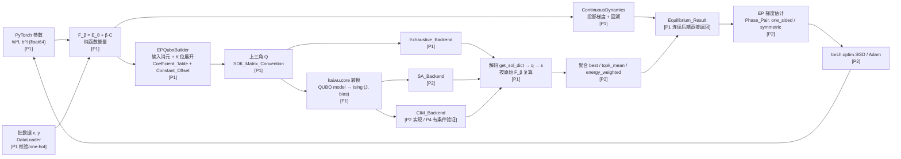

# Design Document：ep-p1-energy-qubo

## Overview

P1 补做申请书里程碑 M1"能量和 argmin 等价"：在 Upstream_Clone 的 `src/kaiwu/torch_plugin/` 中落地 EPConfig、EP_Module 的能量计算、Continuous_Backend、K 位 QUBO_Builder、最小 Solver_Adapter 与 Exhaustive_Backend，并用 Level_1_Test 证明 F_β、QUBO、Ising_Objective 两两只差常数、解码后 argmin 集合一致。

本文件同时是五期计划的共享架构文档。Architecture、分期路线图、待核实假设三节对 P1–P4 全部有效；P2–P4 的 design.md 以 `#[[file:.kiro/specs/ep-p1-energy-qubo/design.md]]` 引用本文件，只写各期增量，不重复定义模块边界、依赖方向、位索引布局与测试分层。后续期需要改动这些共享约定时，先改本文件，再改各期文档。

P1 的核心设计取向：

- 单一能量定义。E_θ、C、F_β 以纯函数实现一次，EP_Module、Continuous_Backend、QUBO_Builder 的复算与测试都调用它，避免多处实现产生漂移。
- QUBO 是 F_β 的精确重写，不是近似。Coefficient_Table 由 F_β 在 K_Bit_Encoding 下逐项展开得到，Constant_Offset 显式保存，等价性由全枚举测试直接断言。
- Kaiwu_SDK 是可替换的外部边界。只在 `_ep_solver.py` 内经可注入的提供者访问，其余模块在未安装 Kaiwu 时完整可用。
- 为 P2 预留扩展点但不提前实现：EPConfig 字段一次到位，聚合、SA/CIM、`scale` 策略、`equilibrate()` 只保留接口位置。

## Architecture

### 数据流



P1 覆盖从参数到 Equilibrium_Result 的全部确定性路径（连续后端与穷举后端），以及 Ising 转换与解码；随机求解、聚合、梯度与优化器闭环从 P2 开始。

### 源文件职责与依赖方向

五个源文件按"底层无依赖 → 顶层组装"排列，依赖只能自上而下：

```
_ep_training.py (P2)          EPTrainer：训练循环、Phase_Pair 调度、日志
        │
        ▼
equilibrium_propagation.py    EPConfig、EquilibriumPropagation；组装后端；再导出错误类型
        │
        ▼
_ep_solver.py                 SolverAdapter、Exhaustive_Backend、Kaiwu 提供者、变量映射与解码
        │
        ▼
_ep_qubo.py                   EPQuboBuilder、BitLayout、K_Bit_Encoding、Coefficient_Table、SDK 矩阵导出
        │
        ▼
_ep_dynamics.py               底层：EP_Error 层级、Equilibrium_Result、MAX_STATE_BITS、
                              纯函数能量 E_θ/C/F_β 及 ∇_s、ContinuousDynamics
```

依赖规则：

| 文件 | 可导入的项目内模块 | 禁止 |
|---|---|---|
| `_ep_dynamics.py` | 无（仅 torch、标准库） | 导入任何 `_ep_*` 与 `equilibrium_propagation` |
| `_ep_qubo.py` | `_ep_dynamics` | 导入 `_ep_solver`、`equilibrium_propagation`、kaiwu |
| `_ep_solver.py` | `_ep_dynamics`、`_ep_qubo` | 导入 `equilibrium_propagation`；模块级导入 kaiwu |
| `equilibrium_propagation.py` | 上述三者 | 导入 `_ep_training` |
| `_ep_training.py` | 上述全部 | 被下层导入 |

关键选择：错误层级与 Equilibrium_Result 放在 `_ep_dynamics.py`。

- 候选 A（采用）：放入 `_ep_dynamics.py`。该文件本就是最底层（纯 torch 能量与连续动力学），把"无依赖的共享定义"放在这里不引入新文件，符合总需求 22.1 固定的五文件布局。
- 候选 B（备选）：新建 `_ep_errors.py`/`_ep_types.py`。职责更清晰，但超出 22.1 的文件清单，需导师同意。由于公共访问路径统一经 `equilibrium_propagation.py` 再导出，日后从 A 切到 B 不改变公共 API。
- 候选 C（否决）：放入 `equilibrium_propagation.py`。下层模块抛错时需反向导入顶层，形成循环。

EPConfig 定义在 `equilibrium_propagation.py`（需求所定），下层模块不导入它：ContinuousDynamics、EPQuboBuilder、SolverAdapter 的构造参数为显式标量（`step_size`、`state_bits`、`exhaustive_max_bits` 等），另提供 `from_config(cfg)` 类方法，在方法内部只读属性、不做类型导入（类型标注用 `TYPE_CHECKING` 守卫）。能量纯函数的输入是 `weights: Sequence[Tensor]`、`biases: Sequence[Tensor]`，不依赖 EP_Module 实例，因此 QUBO 复算与测试可以脱离 `nn.Module` 调用。

### 公共 API 全貌

| 符号 | 所在文件 | P1 实现范围 | 后续期 | `__init__` 导出 |
|---|---|---|---|---|
| `EPConfig` | `equilibrium_propagation.py` | 全部字段、校验、`to_dict`/`from_dict` 往返；`aggregation` 等字段只校验不执行 | P2 接入运行时行为 | P1 |
| `EquilibriumPropagation` | `equilibrium_propagation.py` | 参数注册与初始化、`state_dict` 键名、输入规范化（dtype、one-hot、校验）、`energy`/`cost`/`total_energy` | P2：`equilibrate()`、`train_batch()`、`predict()` | P1 |
| `ContinuousDynamics` | `_ep_dynamics.py` | 投影梯度下降、回溯、判停、`energy_trace`，直接返回 Equilibrium_Result | P2 经 `equilibrate()` 统一调用 | 不导出（模块路径访问） |
| `EPQuboBuilder` | `_ep_qubo.py` | 位布局模板、输入消元、Coefficient_Table、Constant_Offset、SDK 上三角 Q、系数统计、`coefficient_policy="error"` | P2：`scale` 策略 | 不导出 |
| `SolverAdapter` | `_ep_solver.py` | Kaiwu 问题构造、Ising 转换、变量映射、解码、版本读取、调用 Exhaustive_Backend | P2：SA、聚合、重试、`to_dict()`、版本告警、缺失报错；P4：CIM 有条件验证 | P2 或以后 |
| `EPTrainer` | `_ep_training.py` | 不实现 | P2 新建 | P2 或以后 |
| EP_Error 层级 | `_ep_dynamics.py` 定义，`equilibrium_propagation.py` 再导出 | 八个类全部定义；P1 实际抛出配置、动力学、系数范围、求解错误 | P2 起抛出配对、授权、数值错误 | 不进 `__init__`，经 `kaiwu.torch_plugin.equilibrium_propagation` 访问 |

未导出到 `__init__` 的类在 P1 仍写完整 docstring（需求 10.1 针对全部公共类与函数）。

### SDK 边界

Solver_Adapter 只允许调用总需求 7.9 列出的 6 个 Kaiwu API：

| API | 用途 | 首次使用期 |
|---|---|---|
| `kaiwu.core.qubo_matrix_to_qubo_model` | 上三角 Q → QUBO 模型 | P1 |
| `kaiwu.core.qubo_model_to_ising_model` | QUBO 模型 → Ising 模型（J、bias、变量表） | P1 |
| `kaiwu.core.get_sol_dict` | 自旋解 → 变量取值字典 | P1 |
| `kaiwu.classical.SimulatedAnnealingOptimizer` | SA_Backend | P2 |
| `kaiwu.cim.CIMOptimizer` | CIM_Backend | P2/P4 |
| `kaiwu.preprocess.PrecisionReducer` | 精度约简（配合 `scale` 或 CIM） | P2 |

设计约束：

- 延迟导入。四个 P1 源文件的模块顶层不出现任何 `import kaiwu.core`/`kaiwu.classical`/`kaiwu.cim`/`kaiwu.preprocess`。Kaiwu 访问集中在 `_ep_solver.py` 的一个私有提供者函数中，首次调用依赖 Kaiwu 的方法时才执行。
- 可注入提供者。`SolverAdapter(..., kaiwu_provider: Callable[[str], ModuleType] | None = None)`，提供者按子模块名（`"core"`、`"classical"`、`"cim"`、`"preprocess"`）返回模块对象；默认实现为 `importlib.import_module(f"kaiwu.{name}")` 并缓存。测试注入 fake 对象（迁移 Migration_Source 中 `FakeCore`/`fake_kaiwu` 的思路重写），不需要 monkeypatch 全局导入。
- 白名单收口。适配器内部通过 `_kaiwu_attr(submodule, attr)` 取属性，`attr` 必须在上表内；这让"只用 6 个 API"可以用一个静态测试（扫描源文件中 `kaiwu.` 属性访问）加一个 fake 提供者记录调用来验证。
- 版本读取固定用 `importlib.metadata.version("kaiwu")`，不读 `kw.__version__`。P1 只读取并写入元数据，告警在 P2。
- P1 中 Kaiwu 不可用时不引入新的错误路径：依赖 Kaiwu 的测试按需求 9.5 显式跳过；缺失报错（总需求 7.10）在 P2 统一实现为求解错误。

### 位索引布局

对 `layer_sizes = [n_0, n_1, …, n_L]`、`K = state_bits`，只有 `s^1..s^L` 参与编码。定义层偏移

```
offset_1 = 0
offset_l = Σ_{m=1..l−1} n_m        (l = 2..L)
```

第 l 层第 i 个神经元（0 起）的第 k 位（k = 0 为最低位，权重 2^k）的全局 Logical_Bit 索引为

```
g(l, i, k) = K · (offset_l + i) + k,    l ∈ [1, L], i ∈ [0, n_l), k ∈ [0, K)
```

即"层 → 神经元 → 位"的行主序，同一神经元的 K 位连续存放。总位数 `N = K · Σ_{l=1..L} n_l`。

选择理由：

- 同一神经元的位连续，神经元内部的二次项（K 位展开 `s_i²` 产生的 `q_{i,k}q_{i,k'}`）落在 K×K 对角块内，Q 的稀疏结构按块可读，便于调试与统计。
- 解码是 reshape：长度 N 的位向量 → `(Σ n_l, K)` → 与权重向量 `2^k/(2^K−1)` 点积 → 按层偏移切分，无需查表。
- 布局只由 `(layer_sizes, K)` 决定，作为 BitLayout 模板缓存（满足需求 5.9 的"模板构造计数为 1"）；与 Kaiwu 变量名的对应在 Solver_Adapter 内按变量表建立，不把 Kaiwu 命名规则写进布局。
- Auxiliary_Spin 不占 Logical_Bit 索引，只在 Ising 侧存在，由 Solver_Adapter 识别并在解码时按全局翻转规范处理。

### 测试分层

| 层级 | 运行条件 | P1 覆盖内容 | 跳过规则 |
|---|---|---|---|
| Level_1（纯 Torch） | 无 Kaiwu、无授权、无网络 | EPConfig 校验与往返、参数与 `state_dict`、能量与解析梯度、连续后端收敛与确定性、K 位编码往返、F_β↔QUBO 全枚举、上三角约定、系数统计与超限报错、穷举后端、错误层级、"未安装 Kaiwu 可用" | 不跳过 |
| Level_1（fake SDK） | 无 Kaiwu，注入 fake 提供者 | 变量映射、Auxiliary_Spin 识别、多于 1 个辅助自旋/变量数不符时报错、只调用白名单 API | 不跳过 |
| Level_1（真实转换） | 已安装 `kaiwu==1.4.1`，无需授权 | 三方等价的 Ising 部分：`H(σ)+Constant_Offset=F_β`、`get_sol_dict` 解码、±σ 同解码、三方 argmin 一致 | 转换 API 不可调用时仅跳过 Ising 部分，F_β↔QUBO 部分照常执行 |
| Level_2 | Kaiwu 授权（真实 SA）或 CIM 授权/网络/配额 | P1 只注册标记与跳过工具，无实际用例 | 条件不满足时 skip，信息写明缺失项 |

性能预算：Level_1 单进程 CPU 总耗时 ≤ 120 秒。全枚举规模由 Micro_Network 控制（`[2, 3, 1]`、`[2, 2, 2, 1]` 在 K = 2 时分别为 8 与 10 位，最多 1024 个赋值），性质测试固定种子、每项至少 100 组输入。

## 分期路线图

周次按第 3 周起始 2026-09-29 推算，每周周一至周日。

| 分期 | 规格名 | 周次（日期） | 对应总需求 | 退出门禁 | PR 节点 |
|---|---|---|---|---|---|
| P0 | `ep-p0-upstream-setup` | 第 3 周（9/29–10/5） | 环境与上游准备 | Upstream_Clone 就位；Python 3.10 + `kaiwu==1.4.1` 可用；上游既有测试回归结果已记录 | Dep_PR 先行（依赖/环境相关改动，若需要） |
| P1 | `ep-p1-energy-qubo`（本期） | 第 3–5 周（9/29–10/19） | 1.1–1.12、2.1–2.8、3.1–3.6、4.1–4.7、5.1–5.9、6.1–6.8、7.7、7.12、8.1–8.2、11.11、15.1、15.3、15.4、17.1/17.2/17.3/17.9/17.10/17.12/17.13 子集、21.7、22.1–22.4 | 见 requirements.md 退出门禁四条：Level_1 全过且 ≤ 120 秒；覆盖 `[2, 3, 1]` 与双隐层结构；公共 API 有 docstring；布局、导出、SPDX、lint 合规 | P1 结束提交能量/QUBO PR |
| P2 | `ep-p2-training-loop` | 第 5–7 周（10/13–11/2） | 7 其余、8.3–8.10、9、10、11.1–11.10、12、13、14、15.2、15.5–15.9、16.1–16.4、17.4–17.8、17.11、17.13 其余、23.1–23.3、23.5 | 以 P2 规格为准；至少包含 SA 后端、聚合、EP 梯度与训练循环的 Level_1 测试通过 | 训练循环 PR（或并入能量 PR 的后续提交） |
| P3 | `ep-p3-digits-experiments` | 第 7–9 周（10/27–11/16） | 16.5、18、19.1–19.3、19.9–19.14、20、23.4、24.1 | 以 P3 规格为准；主实验结果与报告可复现 | 24.1 draft PR |
| P4 | `ep-p4-ablation-delivery` | 第 10–12 周（11/17–12/7） | 19.4–19.8、CIM 有条件验证、21、22 其余、23.7、24 其余 | 以 P4 规格为准；消融、文档与交付物齐备 | 最终 PR 转正式评审 |

PR 策略默认增量提交：Dep_PR 先行，P1 结束时提交能量/QUBO PR，后续期在其上追加。是否改为单一大 PR 待导师确认；两种方式都不影响本文件的模块边界。

相邻分期的首尾周重叠（第 5、7 周）用于前一期收尾与后一期规格生成并行，不代表两期同时开发同一模块。

关键路径：

```
P0 环境 → P1 能量纯函数 → QUBO 构造与全枚举等价 → Ising 转换与解码
       → P2 SA_Backend + 聚合 → EP 梯度 + 训练循环 → P3 digits 主实验 → P4 消融与交付
```

其中"Ising 转换与解码"是 P1 唯一依赖外部 SDK 的环节，也是 P2 SA/CIM 的共同前提，优先在第 4 周内打通。

降级方案（按触发顺序）：

- K = 1 先行。P1 先让 K = 1 全链路（编码、QUBO、Ising、解码、穷举）通过，再扩到 K = 2 与 K = 3；三方等价测试的门禁只要求 K = 1 与 K = 2。
- K = 3 与 CIM 标注"未运行"。时间或配额不足时，K = 3 的离散实验与 CIM 验证在报告中标注"未运行"并说明原因，不以替代结果冒充。
- 压缩消融。P4 时间不足时优先保留主结论所需的消融项，其余项列入后续工作。
- 若 P1 在第 5 周末未过门禁，P2 起始顺延，从 P3/P4 的消融与可选实验中扣减时间，不压缩 P1/P2 的测试范围。

P2–P4 的 requirements/design/tasks 在各自到期前（前一期收尾周）再生成，届时引用本文件并按实际进度修订路线图。

## 待核实假设

以下假设在 P0 交接后确认，确认结果回写本节。

1. "未安装 Kaiwu 仍可用"的测试方法。`kaiwu.torch_plugin` 与 Kaiwu_SDK 同处 `kaiwu` 命名空间，环境中卸载 Kaiwu 可能连带影响 `kaiwu` 包本身的导入，无法直接在同一环境模拟"未安装"。
   - 默认方案：在子进程中运行测试脚本，先把 `sys.modules["kaiwu.core"]`、`["kaiwu.classical"]`、`["kaiwu.cim"]`、`["kaiwu.preprocess"]` 置为 `None`（使对应导入抛 `ImportError`），再导入 `kaiwu.torch_plugin`，执行 EPConfig、EP_Module 能量、ContinuousDynamics、EPQuboBuilder 与 Exhaustive_Backend 的最小流程。子进程隔离避免污染主测试进程的模块缓存。配合一条静态测试：用 `ast` 扫描四个源文件，断言模块顶层无上述子模块导入。
   - 备选：若 `kaiwu/__init__.py` 本身会急切导入 SDK 子模块（屏蔽后连 `kaiwu` 都无法导入），改为在子进程中安装 `sys.meta_path` 拦截器，只放行 `kaiwu` 与 `kaiwu.torch_plugin`；仍不可行时，由 CI 另建一个仅安装插件、不装 SDK 的环境运行该测试，并在报告中说明。

2. Level_2 pytest 标记的注册位置。
   - 默认方案：若上游已有 `pyproject.toml` 的 `[tool.pytest.ini_options]`，在其 `markers` 中追加 `ep_level2`（附说明文字）；跳过条件与原因文案放在 `tests/conftest.py` 的 fixture 或 helper 中。
   - 备选：上游使用 `pytest.ini`/`setup.cfg` 时写入对应文件；若上游无任何 pytest 配置，只在 `tests/conftest.py` 的 `pytest_configure` 中调用 `config.addinivalue_line("markers", ...)`，避免新增配置文件。

3. lint 与格式工具。
   - 默认方案：沿用上游已配置的工具与版本（按 `pyproject.toml`、`setup.cfg`、`.pre-commit-config.yaml`、CI 工作流的顺序查找），新文件不引入新工具。
   - 备选：上游未配置任何工具时，以 `flake8`（行宽取上游现有代码的实际值）作为 PEP 8 检查，本地运行但不向上游提交新的工具配置，是否纳入由导师决定。

4. 上游包布局与 `__init__` 导出方式。
   - 默认方案：`src/kaiwu/torch_plugin/__init__.py` 采用显式 `from .module import Name` 并维护 `__all__`；P1 追加 `from .equilibrium_propagation import EPConfig, EquilibriumPropagation` 并把两者加入 `__all__`，保留全部既有导出与顺序。
   - 备选：若上游用通配导入或无 `__all__`，按其现有风格追加两行显式导入，不重构既有导出；若上游 `kaiwu` 为命名空间包（无 `kaiwu/__init__.py`），假设 1 的屏蔽方案可直接生效，无需备选拦截器。

5. Kaiwu 变量表与 Auxiliary_Spin 的形态（补充）。
   - 默认方案：`qubo_matrix_to_qubo_model(Q)` 产生的变量名可按 Q 的行列序与全局索引 `g(l, i, k)` 一一对应，Ising 模型比 QUBO 多出至多 1 个辅助自旋；Solver_Adapter 依据变量表名称建立映射，不依赖位置顺序。
   - 备选：若变量名不含可解析的索引，改为以"对单位向量 q 逐一构造并比对 `get_sol_dict` 输出"的方式在首次构造时探测映射，并缓存到 BitLayout 模板。

## Components and Interfaces

下文签名为设计约定，类型标注省略 `Optional` 等细节；张量默认 `torch.float64`、CPU。

### 错误层级（`_ep_dynamics.py`）

```python
class EPError(Exception): ...
class EPConfigError(EPError, ValueError): ...      # 配置与调用参数不合法
class EPDynamicsError(EPError): ...                # 连续后端能量上升
class EPCoefficientRangeError(EPError): ...        # 系数/动态范围超限
class EPPairingError(EPError): ...                 # P2 起抛出
class EPSolverError(EPError): ...                  # 变量映射、穷举超限
class EPAuthorizationError(EPError): ...           # P2 起抛出
class EPNumericalError(EPError): ...               # P2 起抛出
```

输入校验错误的归属：需求 2.7、3.5、3.6 要求抛 `ValueError`，总需求 15.1 要求显式错误继承 EP_Error。复用 `EPConfigError` 而不新增第九个类，语义定为"配置或调用参数不合法"。理由：八类名称已在第一部分固定，`EPConfigError` 已同时是 `ValueError`，调用方用 `except ValueError` 或 `except EPError` 都能捕获；运行中出现的 NaN/Inf（非调用方传入）留给 P2 的 `EPNumericalError`。

### EPConfig（`equilibrium_propagation.py`）

`@dataclass(frozen=True)`，`__post_init__` 完成全部校验，`__eq__` 用 dataclass 默认实现。`layer_sizes` 在内部规范化为 `tuple[int, ...]`，`to_dict()` 输出为 `list`；`from_dict()` 再转回 tuple，保证往返后相等。

| 字段 | 默认值 | 说明 |
|---|---|---|
| `layer_sizes` | 必填 | 长度 ≥ 2，正整数 |
| `beta` | 0.2 | 有限且 ≥ `beta_min` |
| `beta_min` | 1e-3 | 正有限数 |
| `free_steps` / `nudged_steps` | 100 / 50 | 正整数 |
| `step_size` | 0.5 | 正有限数；每步回溯从该值起算 |
| `max_backtracks` | 20 | 非负整数；0.5^20 ≈ 1e-6 足以覆盖病态初值 |
| `residual_tol` / `state_tol` | 1e-6 / 1e-6 | 正有限数 |
| `state_bits` | 1 | 1..`MAX_STATE_BITS` |
| `aggregation` | `"best"` | P1 只校验 |
| `topk` | 4 | `topk_mean` 时须为正整数 |
| `aggregation_temperature` | 1.0 | `energy_weighted` 时须为正有限数 |
| `initial_state_policy` | `"shared"` | P1 只校验 |
| `gradient_estimator` | `"one_sided"` | P1 只校验 |
| `seed` | 0 | 非负整数 |
| `exhaustive_max_bits` | 16 | 正整数；2^16 = 65536 次向量化复算在 CPU 上约 0.1 s |
| `coefficient_limit` | 1e3 | 正有限数 |
| `dynamic_range_limit` | 1e9 | 正有限数 |
| `coefficient_policy` | `"error"` | P1 允许取值仅 `{"error"}`，P2 扩展 `"scale"` |

常量：`MAX_STATE_BITS = 4`（定义于 `_ep_dynamics.py`，由 EPConfig 读取）。取 4 而非 3：K = 3 为主实验上限，多留一档供消融而不改 API；`[64, 32, 10]` 在 K = 4 时为 168 位，编码往返测试成本仅 2^4 个取值。

系数上限理由：两者只是 float64 精确性护栏，硬件精度约束交给 P2 的 `scale`/PrecisionReducer。|c| ≤ 1e3 时，N ≤ 168 位的 qᵀQq 累加舍入误差量级约 √(N²)·1e3·2.2e-16 ≈ 4e-11，低于 1e-9 的等价容差；动态范围 1e9 保证最小非零系数仍高于累加噪声 3 个数量级以上。随机初始化权重会产生接近 0 的元素，动态范围取值不宜更紧。"非零"按 `c != 0.0` 精确判定。

`from_dict(d)`：必需键为无默认值的字段（仅 `layer_sizes`），其余缺省取默认值；未知键与缺失必需键一次性列出后抛 `EPConfigError`。这样 `from_dict(d)` 与 `EPConfig(**d)` 语义一致。

### EquilibriumPropagation（`equilibrium_propagation.py`）

```python
class EquilibriumPropagation(nn.Module):
    def __init__(self, config: EPConfig, *, dtype=torch.float64, device=None): ...
    weights: tuple[Tensor, ...]   # 只读属性，(W_0, …, W_{L-1})
    biases: tuple[Tensor, ...]    # 只读属性，(b_1, …, b_L)
    def prepare_batch(self, x, y=None) -> tuple[Tensor, Tensor | None, bool]: ...
    def energy(self, x, states) -> Tensor: ...
    def cost(self, states, y) -> Tensor: ...
    def total_energy(self, x, states, y, beta) -> Tensor: ...
```

- state_dict 键名：用 `register_parameter` 逐个注册 `W_0 … W_{L−1}`，再注册 `b_1 … b_L`。选这一种而非 `ParameterList` 的 `weights.0/biases.0`：键中下标与公式 W^l、b^l 一致，避免 `biases.0` 对应 b^1 的错位；注册顺序固定，键集合只由 `layer_sizes` 决定。
- 确定性初始化：`g = torch.Generator(device="cpu"); g.manual_seed(config.seed)`，按 l = 0..L−1 顺序在 CPU float64 上 `W_l.uniform_(−1/√n_l, 1/√n_l, generator=g)`（n_l 为 W^l 的扇入，沿用迁移源 `1/√n_in` 规则），偏置全 0，最后 `.to(device, dtype)`。不触碰全局 RNG。
- `prepare_batch`：`x` 为 `(n_0,)` 或 `(B, n_0)`，转为参数 dtype；`y` 为 `(B,)` 整型类别索引时转 one-hot，为 `(B, n_L)` 浮点时校验 [0,1]；返回 `single` 标志供结果还原为标量。
- `energy/cost/total_energy` 只做校验与形状处理，计算委托下述纯函数。

### 能量纯函数（`_ep_dynamics.py`）

```python
def energy_fn(weights, biases, x, states) -> Tensor            # (B,)
def cost_fn(s_last, y) -> Tensor                              # (B,)
def total_energy_fn(weights, biases, x, states, y, beta) -> Tensor
def state_gradient_fn(weights, biases, x, states, y, beta) -> tuple[Tensor, ...]
```

- 纯函数不做校验，假定输入已规范为 `(B, ·)`。
- `total_energy_fn` 在 `beta == 0` 时直接返回 `energy_fn(...)`，不计算 `0·C`，`y` 可为 `None`；由此 `F_0 = E_θ` 逐元素精确成立，且不受 `y` 中 NaN 影响。
- 状态梯度：`∇_{s^l}F = s^l − (W^{l−1})ᵀs^{l−1} − W^l s^{l+1} − b^l`，批行向量写法为 `s^l − s^{l−1} @ W_{l−1} − s^{l+1} @ W_lᵀ − b_l`，`l = L` 时去掉上层项并加 `β(s^L − y)`。解析实现，不走 autograd，保证连续后端确定且快。

### ContinuousDynamics（`_ep_dynamics.py`）

```python
class ContinuousDynamics:
    def __init__(self, step_size, max_backtracks, residual_tol, state_tol): ...
    @classmethod
    def from_config(cls, cfg) -> "ContinuousDynamics": ...
    def run(self, weights, biases, x, y, beta, max_steps, *, initial_state=None,
            phase="free") -> EquilibriumResult: ...
```

- 全程 `torch.no_grad()`，状态 detach。`initial_state=None` 时各层取 0。
- 每步：逐样本步长 `η_b = step_size`，候选 `s' = clamp(s − η∇F, 0, 1)`（输入层不参与）；对 `F(s') > F(s) + ε_mono` 的样本把 `η_b` 减半重算，至多 `max_backtracks` 次。`ε_mono = 1e-12·max(1, |F(s_t)|)` 逐样本计算。
- 回溯耗尽仍上升：构造 `stop_reason="energy_increase"` 的部分结果挂在异常属性 `result` 上，抛 `EPDynamicsError`。
- 判停在接受步之后：残差 `‖s_{t+1} − Π(s_{t+1} − ∇F(s_{t+1}))‖_∞` 与 `‖s_{t+1} − s_t‖_∞`，取整批最大值；全部样本同时满足才 `converged`，否则到 `max_steps` 记 `max_steps`。
- `energy_trace` 形状 `(T+1, B)`，含初始能量。无随机性、无数据相关分支之外的状态，重复运行逐元素相同。

### BitLayout（`_ep_qubo.py`）

```python
@dataclass(frozen=True)
class BitLayout:
    layer_sizes: tuple[int, ...]; state_bits: int; n_bits: int
    layer_offsets: tuple[int, ...]         # 神经元级偏移 offset_l
    bit_weights: Tensor                    # (K,) = 2^k / (2^K − 1)
    quad_index: Tensor                     # (2, M) int64，i < j，字典序
    def index(self, l, i, k) -> int
    def encode(self, states) -> Tensor     # (B, N) ∈ {0,1}
    def decode(self, q) -> tuple[Tensor, ...]
```

- 索引按第一部分 `g(l, i, k)`。`quad_index` 由两类块拼接：神经元内 K×K 严格上三角对（每层每神经元 `K(K−1)/2` 对），以及相邻层块 `(g(l,i,k), g(l+1,j,k'))`（`n_l·n_{l+1}·K²` 对）；因 `g(l,·) < g(l+1,·)`，层间对天然 i < j。
- `decode`：`q.reshape(B, Σn_l, K) @ bit_weights` 后按 `layer_offsets` 切分。
- `encode`：`m = round(v·(2^K−1))`，要求 `|v − m/(2^K−1)| ≤ 1e-12`（否则 `EPConfigError`，信息含最大偏差），再取二进制位 `(m >> k) & 1`。

### EPQuboBuilder（`_ep_qubo.py`）

```python
class EPQuboBuilder:
    template_builds: int                   # 模板构造计数
    def __init__(self, state_bits, coefficient_limit=1e3, dynamic_range_limit=1e9,
                 coefficient_policy="error"): ...
    @classmethod
    def from_config(cls, cfg): ...
    def layout(self, layer_sizes) -> BitLayout            # 按 (layer_sizes, K) 缓存
    def build(self, weights, biases, x, y, beta) -> CoefficientTable   # 单样本 x: (n_0,)
    def to_upper_triangular(self, table) -> Tensor        # (N, N)
    def evaluate(self, table, q) -> Tensor                # (M,) = Σa q + Σc qq + offset
```

模板缓存为实例字典 `{(layer_sizes, K): BitLayout}`，未命中时 `template_builds += 1`；不用全局缓存，保证测试间隔离。

系数推导（记 `w_k = 2^k/(2^K−1)`，`s_{l,i} = Σ_k w_k q_{l,i,k}`，`[l=L]` 为输出层指示）：

| F_β 中的项 | 线性系数 `a_{g(l,i,k)}` 增量 | 二次系数 `c` 增量 | 常数 |
|---|---|---|---|
| `½ s_{l,i}²`（用 q² = q 折入） | `½ w_k²` | `(l,i,k)<(l,i,k')`：`w_k w_{k'}` | — |
| `−b^l_i s_{l,i}` | `−b^l_i w_k` | — | — |
| 输入消元 `−xᵀW⁰s¹`，`h_i = (xᵀW⁰)_i` | `l = 1`：`−h_i w_k` | — | — |
| 层间 `−(s^l)ᵀW^l s^{l+1}`，l = 1..L−1 | — | `(l,i,k),(l+1,j,k')`：`−W^l_{ij} w_k w_{k'}` | — |
| `β·½‖s^L‖²` | `l = L`：`β·½ w_k²` | 神经元内：`β w_k w_{k'}` | — |
| `−β yᵀs^L` | `l = L`：`−β y_i w_k` | — | — |
| `β·½‖y‖²` | — | — | `Constant_Offset` |

- 汇总：线性 `a = (1+β[l=L])·½w_k² − (b^l_i + [l=1]h_i + [l=L]βy_i)·w_k`；神经元内二次 `(1+β[l=L])·w_k w_{k'}`；层间块为 `−W^l ⊗ (w wᵀ)`（Kronecker 积，与神经元主序布局对齐，一次向量化写入）。`L = 1` 时 `l = 1` 同时是输出层，两类修正叠加。
- `Constant_Offset = ½β‖y‖²`，β = 0 时恒为 0.0，且 `y` 不参与任何运算，满足需求 5.7/5.10。
- 上三角导出：`Q = zeros(N,N)`；`Q[diag] = a`；`Q[quad_index[0], quad_index[1]] = c`；下三角恒 0。每个无序对只写一次，不做对称化，从源头排除"非对角加倍"。
- 统计：`n_bits`、`n_quadratic_nonzero`、`max_abs`、`min_nonzero_abs`、`dynamic_range`，对线性与二次系数合并统计（与 SDK 看到的 Q 元素一致）；全零问题时 `min_nonzero_abs = None`、`dynamic_range = 1.0`。统计后按 `coefficient_policy="error"` 检查，超限抛 `EPCoefficientRangeError`。

### SolverAdapter 最小实现（`_ep_solver.py`）

```python
class SolverAdapter:
    def __init__(self, builder, *, exhaustive_max_bits=16, kaiwu_provider=None): ...
    @classmethod
    def from_config(cls, cfg, *, kaiwu_provider=None): ...
    def build_kaiwu_problem(self, table) -> KaiwuIsingProblem
    def ising_energy(self, problem, sigma) -> Tensor        # (M,) = −σᵀJσ + ising_bias
    def decode_spins(self, problem, sigma) -> tuple[Tensor, tuple[Tensor, ...]]
    def solve_exhaustive(self, weights, biases, x, y, beta) -> EquilibriumResult
    @staticmethod
    def kaiwu_version() -> str | None
```

- `build_kaiwu_problem`：`Q = builder.to_upper_triangular(table).numpy()` → `_kaiwu_attr("core", "qubo_matrix_to_qubo_model")(Q)` → `_kaiwu_attr("core", "qubo_model_to_ising_model")(qubo_model)`；读取 `get_matrix()`、`get_variables()`、`get_bias()`。
- 变量映射：对变量表每个名字尝试解析为 Logical_Bit 下标（解析规则以真实 1.4.1 输出为准；迁移源 fake 使用 `b[i]` 与 `__spin__`，按待核实假设 5 处理）。解析成功的名字须恰好覆盖 `0..N−1` 各一次；无法解析的名字即 Auxiliary_Spin 候选，至多 1 个。违反任一条抛 `EPSolverError`（期望 N/N+1，实际变量数与多余名字）。结果存为 `bit_to_spin: LongTensor (N,)` 与 `aux_index`。
- ±σ 规范：解码前先规范化 `σ ← σ·σ_aux`（使辅助自旋为 +1），再调用 `_kaiwu_attr("core", "get_sol_dict")(σ, variables)`，按映射组装 `q (N,)`，经 `layout.decode` 得 Layer_State。先规范化再解码，使 ±σ 结论不依赖 `get_sol_dict` 自身是否处理规范。无辅助自旋时（线性项全零）不做规范化，此时 ±σ 是两个不同物理解，需求 6.7 的性质测试在生成器中断言辅助自旋存在。
- `get_sol_dict` 返回值须全在 {0,1}，否则 `EPSolverError`。
- `kaiwu_version()`：`importlib.metadata.version("kaiwu")`，`PackageNotFoundError` 时返回 `None`，写入元数据。
- `_kaiwu_attr(sub, attr)`：先查白名单，再经 `kaiwu_provider(sub)` 取模块并 `getattr`；首次调用才触发导入。

### Exhaustive_Backend（`_ep_solver.py`）

```python
class ExhaustiveBackend:
    def __init__(self, max_bits=16, chunk_size=4096, tie_tol=1e-9): ...
    def solve(self, layout, weights, biases, x, y, beta) -> EquilibriumResult
```

- 先检查 `layout.n_bits > max_bits` → `EPSolverError`（含位数与上限），不分配任何枚举内存。
- 向量化枚举：按块 `idx = arange(start, start+chunk)`，`q = ((idx[:, None] >> arange(N)) & 1).to(float64)`，`layout.decode(q)` 后以 `total_energy_fn` 复算 F_β（x、y 广播到块大小）。按原始 F_β 裁决，不用 QUBO 值，沿用迁移源"按原始能量复算"的做法。
- 并列：全部能量拼接后取 `E_min`，保留 `E ≤ E_min + 1e-9` 的全部赋值，按整数索引升序，结果确定。`candidates` 保存并列集合，`states` 取其中第一个。

## Data Models

均为 `@dataclass(frozen=True)`，定义位置：`EquilibriumResult`、`Budget`、`SolverMetadata` 在 `_ep_dynamics.py`；`CoefficientTable`、`CoefficientStats` 在 `_ep_qubo.py`；`KaiwuIsingProblem` 在 `_ep_solver.py`。

| 类 | 字段 | 类型 | 填充期 |
|---|---|---|---|
| `EquilibriumResult` | `states` | `tuple[Tensor, ...]`，各 `(B, n_l)` | P1 |
| | `energy` | `Tensor (B,)`，按原始 F_β 复算 | P1 |
| | `beta`、`phase` | `float`、`"free"`/`"nudged"` | P1 |
| | `stop_reason` | `"converged"`/`"max_steps"`/`"energy_increase"`/`"exhaustive"` | P1 |
| | `budget` | `Budget` | P1 |
| | `energy_trace` | `Tensor (T+1, B)` 或 `None`（离散后端） | P1 |
| | `final_residual`、`final_state_change` | `float` 或 `None` | P1 |
| | `backtracks` | `int` | P1 |
| | `candidates`、`candidate_energies` | 并列状态 `tuple[Tensor,...]`（首维为并列数）、`Tensor` | P1（穷举），P2（SA/CIM 候选） |
| | `aggregation_weights`、`best_so_far` | `Tensor` 或 `None` | P2 |
| | `metadata` | `SolverMetadata` | P1 部分 |
| `Budget` | `max_steps`、`steps_taken` | `int` | P1 |
| | `enumerated` | `int` 或 `None`（穷举赋值数） | P1 |
| | `num_reads`、`retries`、`wall_time_s` | `int`/`float` 或 `None` | P2 |
| `SolverMetadata` | `backend` | `"continuous"`/`"exhaustive"`/`"kaiwu_ising"` | P1 |
| | `n_logical_bits`、`coefficient_stats` | `int`、`CoefficientStats` 或 `None` | P1 |
| | `kaiwu_version`、`n_ising_spins`、`auxiliary_spin` | `str`/`int`/`str` 或 `None` | P1 |
| | `solver_params`、`seed`、`warnings` | `dict`/`int`/`tuple[str,...]` | P2 |
| `CoefficientTable` | `layout` | `BitLayout` | P1 |
| | `linear` | `Tensor (N,)` | P1 |
| | `quad_values` | `Tensor (M,)`，与 `layout.quad_index` 对齐 | P1 |
| | `constant_offset`、`beta` | `float` | P1 |
| | `stats` | `CoefficientStats` | P1 |
| | `scale_factor` | `float`，P1 恒 1.0 | P2 |
| `CoefficientStats` | `n_bits`、`n_quadratic_nonzero` | `int` | P1 |
| | `max_abs`、`min_nonzero_abs`、`dynamic_range` | `float`（`min_nonzero_abs` 可为 `None`） | P1 |
| `KaiwuIsingProblem` | `qubo_model`、`ising_model` | SDK 对象 | P1 |
| | `J`、`ising_bias` | `ndarray`、`float` | P1 |
| | `variables`、`bit_to_spin`、`aux_index` | `dict[str,int]`、`LongTensor (N,)`、`int` 或 `None` | P1 |
| | `table` | `CoefficientTable`（解码与复算用） | P1 |

稀疏结构（`quad_index`）只存于 `BitLayout`，`CoefficientTable` 只存值，模板复用即共享同一 `BitLayout` 对象。

## 迁移映射

以实际读到的 Migration_Source 为准。

| 来源 | 目标 | 改写点 |
|---|---|---|
| `mapping.py::build_qubo(V, H_h, H_o, beta)` | `EPQuboBuilder.build` + `to_upper_triangular` | 来源只处理隐层–输出一个耦合块，变量为 ±1 自旋经 `q=(s+1)/2` 换元，常数含 `β·n_o + ΣH − ΣV`；目标为 {0,1} Logical_Bit 直接编码 [0,1] 状态，多层块用 Kronecker 写入，K 位产生神经元内二次项，常数只剩 `½β‖y‖²`。沿用"上三角、对角为线性项、常数显式保存"的约定 |
| `mapping.py::qubo_energy(Q, constant, spins)` | `EPQuboBuilder.evaluate`（表形式）与测试中的 `qᵀQq + offset` | 输入由 ±1 自旋改为 {0,1} 位向量，支持批 `(M, N)`；保留方阵/长度校验 |
| `mapping.py::decode_aux` / `decode_aux_alt` | `SolverAdapter.decode_spins` 的规范化步骤 | 来源假定辅助自旋在末位、按位置取；目标按变量表 `aux_index` 定位，先 `σ·σ_aux` 规范化再交 `get_sol_dict`，输出 {0,1} 位并经 K 位解码 |
| `mapping.py::energy_equivalence_report` | 测试辅助 `assert_constant_offset(a, b, atol)`（放在测试生成器模块） | 来源以首元素差为常数；目标同样取差值的首元素，额外断言该常数与 `Constant_Offset` 相符，残差阈值按需求取 1e-9/1e-8 |
| `mapping.py::minimizer_indices` | `ExhaustiveBackend` 的并列裁决与测试中的 argmin 集合比较 | 来源 `atol=1e-8` 的 Python 循环；目标向量化，容差按需求 7.1 取 1e-9 |
| `mapping.py::iter_physical_states` | `ExhaustiveBackend` 的位移枚举 | ±1 的 `itertools.product` 改为整数位移生成 {0,1} 块 |
| `model.py::IsingEPModel.__init__` 初始化 | `EquilibriumPropagation.__init__` | 沿用私有 `torch.Generator` + `uniform_(±1/√fan_in)`、偏置 0；去掉 `gain_weight*` 与 `spins_per_class`，推广到 L 层 |
| `model.py::energy/cost/free_energy` | `energy_fn/cost_fn/total_energy_fn` | 来源 E 无 `½‖s‖²` 项、代价为 `n_o − y·o`（±1 形式）；目标按 Glossary 的 E_θ 与 `½‖s^L−y‖²` 重写 |
| `test_solve.py::FakeIsingModel` / `FakeCore` / `fake_kaiwu` | `tests/test_ep_solver.py` 中的 fake 提供者 | 来源通过 `monkeypatch.setattr(solve, "_import_kaiwu", ...)` 替换整个 kaiwu；目标直接注入 `kaiwu_provider=lambda name: fakes[name]`，并记录被访问的属性名以检查白名单；`FakeCore.qubo_model_to_ising_model` 返回单位阵的做法保留，用于映射与异常用例，不用于能量等价 |
| `test_kaiwu_mapping.py` 的 `get_sol_dict` 与双规范检查 | `tests/test_ep_kaiwu_conversion.py` | 来源 `_solver_state` 按 ±1 物理自旋构造两种规范并比对 `decode_aux`；目标从 {0,1} 位构造 σ（`σ_bit = (2q−1)·σ_aux`），两种规范都经 `decode_spins`，断言位与 Layer_State 一致、Ising argmin 集合与 F_β argmin 集合一致 |

来源中不存在、需新写的部分：K 位编码、连续后端、系数统计与超限策略、BitLayout 模板缓存、变量名到索引的解析。

## Correctness Properties

*A property is a characteristic or behavior that should hold true across all valid executions of a system-essentially, a formal statement about what the system should do. Properties serve as the bridge between human-readable specifications and machine-verifiable correctness guarantees.*

### Property 1: EPConfig 往返

对任意合法 EPConfig 实例 `cfg`，`cfg.to_dict()` 只含 JSON 基本类型，且 `EPConfig.from_dict(json.loads(json.dumps(cfg.to_dict()))) == cfg`。

**Validates: Requirements 1.10, 1.11**（总需求 1.10、1.11）

### Property 2: EPConfig 非法输入被拒

对任意在恰好一个字段上违反约束的配置字典（非法 `layer_sizes`、`beta < beta_min`、非正步数、越界 `state_bits`、枚举外取值、`topk`/`aggregation_temperature` 条件违规、缺失或未知键），构造或 `from_dict` 抛 `EPConfigError`，且信息包含该字段名（及 1.5、1.8、1.12 要求的数值、允许取值或键列表）。

**Validates: Requirements 1.4, 1.5, 1.6, 1.7, 1.8, 1.9, 1.12**（总需求 1.4–1.9、1.12）

### Property 3: 参数结构与确定性

对任意合法 `layer_sizes` 与 `seed`，两次构造的 EP_Module 的 `state_dict` 键集合为 `{W_0..W_{L−1}, b_1..b_L}`，形状为 `(n_l, n_{l+1})` 与 `(n_l,)`，dtype 为 float64，且对应张量逐元素相等。

**Validates: Requirements 2.1, 2.2, 2.3, 2.5**（总需求 2.1、2.2、2.3、2.5）

### Property 4: 输入规范化与校验

对任意合法批 `x`（float32 或 float64）与类别索引 `y`，`prepare_batch` 返回参数 dtype 的 `x` 与逐行 one-hot 的目标；对任意形状不符、含 NaN/Inf、类别越界、状态超出 [0,1] 超过 1e-12、层数或宽度不符、`beta` 为负或非有限的输入，抛 `EPConfigError`（即 `ValueError`），信息含参数名与期望形状或范围。

**Validates: Requirements 2.6, 2.7, 3.5, 3.6**（总需求 2.6、2.7、3.5、3.6）

### Property 5: 能量公式与 F_0 = E_θ

对任意合法参数、输入与 [0,1] 状态，`energy` 与逐项手写求和的参考实现差 ≤ 1e-12，形状为 `(B,)`（单样本为标量）；`total_energy(β) = energy + β·cost`；且 `total_energy(β=0)` 与 `energy` 逐元素相等（与 `y` 取值无关）。

**Validates: Requirements 3.1, 3.2, 3.4**（总需求 3.1、3.2、3.4）

### Property 6: 解析参数梯度

对任意合法参数、输入与分离的状态，对 `energy(...).sum()` 调用 `backward()` 得到的梯度满足 `∂/∂W^l = −Σ_b s^l_b (s^{l+1}_b)ᵀ`、`∂/∂b^l = −Σ_b s^l_b`，最大绝对误差 ≤ 1e-12。

**Validates: Requirements 3.3**（总需求 3.3）

### Property 7: 连续后端投影与单调

对任意 Micro_Network 参数、输入、目标、β ≥ 0 与 [0,1] 初始状态，`ContinuousDynamics.run` 的每个状态都在 [0,1] 内，输入不被修改，且 `energy_trace` 满足 `trace[t+1] ≤ trace[t] + ε_mono(trace[t])`；若出现上升则必以 `EPDynamicsError` 结束。

**Validates: Requirements 4.1, 4.2, 4.3, 4.8, 9.3**（总需求 4.1、4.2、4.3、15.3、17.3）

### Property 8: 连续后端确定性

对任意参数、输入、初始状态与配置，两次 `run` 返回的状态与 `energy_trace` 逐元素相等（`torch.equal`）。

**Validates: Requirements 4.7**（总需求 4.7）

### Property 9: K 位编码往返

对任意 `K ∈ [1, MAX_STATE_BITS]`、任意 `q ∈ {0,1}^N` 有 `encode(decode(q)) == q`；对任意 State_Grid 上的状态 `v` 有 `decode(encode(v)) == v`，且解码值集合恰为 State_Grid。

**Validates: Requirements 5.1, 5.2**（总需求 5.1、5.2、17.13）

### Property 10: Logical_Bit 计数

对任意合法 `layer_sizes` 与 K，`layout.n_bits == K·Σ_{l≥1} n_l`，`index(l,i,k)` 是到 `[0, N)` 的双射。

**Validates: Requirements 5.3**（总需求 5.3）

### Property 11: F_β 与 Coefficient_Table 等价

对任意 Micro_Network 参数、输入、目标、β ≥ 0 与任意 Logical_Bit 赋值 q，`F_β(decode(q)) = Σa_i q_i + Σ_{i<j} c_ij q_i q_j + Constant_Offset`（误差 ≤ 1e-9）；`quad_index` 中无重复无序对，且无任何下标对应输入层。

**Validates: Requirements 5.4, 5.5, 5.6**（总需求 5.4、5.5、5.6）

### Property 12: 上三角 qᵀQq 等价

对任意同上输入与任意 q，`to_upper_triangular` 返回的 Q 下三角全 0，且 `qᵀQq + Constant_Offset = F_β(decode(q))`（误差 ≤ 1e-9）。

**Validates: Requirements 6.1, 6.2**（总需求 6.1、6.2）

### Property 13: β = 0 与 y 无关及两相位相同

对任意参数、输入与任意两个目标 `y1、y2`，β = 0 构造的两个 CoefficientTable 的 `linear`、`quad_values`、`constant_offset` 逐元素相等（`constant_offset == 0.0`）。

**Validates: Requirements 5.7, 5.10**（总需求 5.7、11.11）

### Property 14: 模板复用

对任意 `layer_sizes` 与 K，同一 builder 以不同参数、输入、目标、β 重复 `build` 任意次后，`template_builds == 1`，且各表的 `layout` 为同一对象。

**Validates: Requirements 5.9**（总需求 5.9）

### Property 15: 系数统计与超限报错

对任意 CoefficientTable，`stats` 与对 Q 非零元素的朴素统计一致；对任意 `coefficient_limit` 小于 `max_abs` 或 `dynamic_range_limit` 小于 `dynamic_range` 的 builder，`build` 抛 `EPCoefficientRangeError`，信息含超限统计量与限值；两者均不超限时不抛错。

**Validates: Requirements 5.8, 5.11**（总需求 5.8、15.4）

### Property 16: Ising 等价

对任意 Micro_Network 问题（K ∈ {1, 2}、β ∈ {0, >0}）与任意自旋解 σ，`H(σ) + Constant_Offset = F_β(s(q(σ)))`（误差 ≤ 1e-8）。

**Validates: Requirements 6.3, 6.5**（总需求 6.3、6.5、17.9）

### Property 17: 变量映射与 ±σ 解码一致

对任意含辅助自旋的问题与任意 σ，`decode_spins(σ)` 与 `decode_spins(−σ)` 给出相同的 q 与 Layer_State，且 q 经 `bit_to_spin` 回写构造的 σ 能再解码回 q；对变量数不符、名字重复或多于 1 个辅助自旋的 fake 变量表，`build_kaiwu_problem` 抛 `EPSolverError`，信息含期望与实际变量数。

**Validates: Requirements 6.4, 6.6, 6.7, 6.8**（总需求 6.4、6.6、6.7、6.8）

### Property 18: 三方 argmin 一致

对任意 Micro_Network 问题（K ∈ {1, 2}、β ∈ {0, >0}），全枚举下 F_β、qᵀQq 与 Ising_Objective（按两种规范解码）的最小值集合在解码后的 Layer_State 上相同，且等于 `ExhaustiveBackend.solve` 的 `candidates`。

**Validates: Requirements 7.1, 9.4**（总需求 8.1、17.9）

### Property 19: 穷举完整性与上限

对任意 `n_bits ≤ exhaustive_max_bits` 的问题，`ExhaustiveBackend` 复算的赋值数为 `2^n`，`candidates` 等于朴素逐一循环得到的 `{q : F(q) ≤ min F + 1e-9}`（按索引升序）；对任意 `n_bits > max_bits` 的布局，枚举前抛 `EPSolverError`，信息含位数与上限。

**Validates: Requirements 7.1, 7.2**（总需求 8.1、8.2）

### Property 20: 延迟导入可用性

在屏蔽 `kaiwu.core/classical/cim/preprocess` 的环境中，导入 `kaiwu.torch_plugin` 并运行 EPConfig、EP_Module 能量、ContinuousDynamics、EPQuboBuilder 与 ExhaustiveBackend 的最小流程均成功；四个源文件的模块顶层不含上述导入；fake 提供者记录到的属性访问全部属于白名单。

**Validates: Requirements 6.10**（总需求 7.12）

### Property 21: 错误层级

对八个错误类中的任意一个，它是 `EPError` 的子类；`EPConfigError` 同时是 `ValueError` 的子类。

**Validates: Requirements 8.1**（总需求 15.1）

## Error Handling

| 错误类型 | 触发条件 | 信息内容 |
|---|---|---|
| `EPConfigError` | EPConfig 字段校验失败（需求 1.4–1.9） | 字段名、收到的值；`beta` 场景含 `beta` 与 `beta_min`；枚举场景列出允许取值 |
| `EPConfigError` | `from_dict` 缺失必需键或含未知键 | 缺失键列表、未知键列表 |
| `EPConfigError` | `x`/`y`/状态形状、层数、宽度不符；含 NaN/Inf；类别越界；状态越界 > 1e-12；`beta` 为负或非有限 | 参数名、期望形状或取值范围、实际形状或越界值 |
| `EPConfigError` | `encode` 收到不在 State_Grid 上的值；`coefficient_policy` 取 P1 未支持的值 | 最大偏差与 K；允许取值 |
| `EPDynamicsError` | 回溯 `max_backtracks` 次后 F_β 仍上升超过 ε_mono | 相位、步数、能量增量、ε_mono；属性 `result` 带 `stop_reason="energy_increase"` 的部分结果 |
| `EPCoefficientRangeError` | `max_abs > coefficient_limit` 或 `dynamic_range > dynamic_range_limit`，且策略为 `"error"` | 超限统计量名称、数值、限值、Logical_Bit 数 |
| `EPSolverError` | 变量表无法一一对应 Logical_Bit，或多于 1 个辅助自旋 | 期望变量数（N 或 N+1）、实际变量数、无法解析的名字 |
| `EPSolverError` | `get_sol_dict` 返回值不在 {0,1} 或缺键 | 异常变量名与取值 |
| `EPSolverError` | 穷举位数超过 `exhaustive_max_bits` | 位数与上限 |
| `EPSolverError` | `_kaiwu_attr` 请求白名单外属性（编程错误防线） | 子模块名与属性名 |
| `EPPairingError`、`EPAuthorizationError`、`EPNumericalError` | P1 仅定义，不抛出 | — |

原则：不吞异常；Kaiwu 自身抛出的异常在 P1 原样上抛（不包装），P2 统一包装为 `EPSolverError`/`EPAuthorizationError`。所有信息用英文书写，便于上游评审，数值用 `repr` 保留精度。

## Testing Strategy

### 文件划分

| 文件 | 内容 | 依赖 |
|---|---|---|
| `tests/test_ep_config.py` | Property 1、2、21；1.2/1.3 默认值示例 | 纯 Torch |
| `tests/test_ep_model.py` | Property 3–6；float64、`torch.optim.SGD/Adam` 单步更新、`DataLoader` 批示例 | 纯 Torch |
| `tests/test_ep_dynamics.py` | Property 7、8；两相位收敛示例（需求 9.3）；`max_steps` 与 `energy_increase` 示例（`max_backtracks=0` 配合故意过大的 `step_size`） | 纯 Torch |
| `tests/test_ep_qubo.py` | Property 9–15；`[64, 32, 10]` 的 42/84/126 示例 | 纯 Torch |
| `tests/test_ep_solver.py` | Property 17 的 fake 部分、19；白名单访问记录 | 纯 Torch + fake 提供者 |
| `tests/test_ep_kaiwu_conversion.py` | Property 16、17（真实规范部分）、18；`kaiwu_version()` 示例 | 已安装 `kaiwu==1.4.1` |
| `tests/test_ep_import_isolation.py` | Property 20：子进程屏蔽 + `ast` 顶层导入扫描 | 纯 Torch |
| `tests/_ep_gen.py` | 随机生成器、`assert_constant_offset`、fake 提供者工厂、Level_2 跳过 helper | — |

`_ep_gen.py` 以下划线开头不被收集；若 `tests/` 为包则相对导入，否则依赖 pytest 默认 `prepend` 导入模式（按待核实假设 2 的查找结果确定）。

### Micro_Network

| 结构 | 隐藏层数 | K = 1 位数 | K = 2 位数 | 用途 |
|---|---|---|---|---|
| `[3, 2]` | 0 | 2 | 4 | L = 1 时输入与输出修正叠加 |
| `[2, 2, 2]` | 1 | 4 | 8 | 基础等价 |
| `[2, 3, 1]` | 1 | 4 | 8 | 门禁指定结构 |
| `[2, 2, 2, 1]` | 2 | 5 | 10 | 双隐层门禁 |

最大 10 位（1024 个赋值），全枚举与复算在毫秒级。K = 3 只做编码往返与 `[2, 3, 1]`（12 位）一次 F_β↔QUBO 抽查。

### 性质测试库

选 `torch.Generator` 自写生成器，不引入 hypothesis。理由：不向上游新增测试依赖（上游是否已有 hypothesis 待 P0 确认），版本随上游已固定的 torch；生成顺序完全由种子决定，失败可复现；枚举型性质本身需要张量批量生成，自写更直接。

- 每个性质测试用 `torch.Generator().manual_seed(20260929 + case_offset)`，至少 100 组输入（Property 1、9 按需求 9.8 强制；其余纯 Torch 性质同样取 100）。
- 生成器：`gen_layer_sizes`（长度 2–4、宽度 1–4）、`gen_params`（`U(−1, 1)`，另以 10% 概率插入 0 与 ±极值以覆盖统计边界）、`gen_state`（含 0、1 端点）、`gen_config`（逐字段在合法域内取样，含边界值）、`gen_invalid_config`（在合法配置上只破坏一个字段）。
- 失败信息打印种子与 case 序号，替代 hypothesis 的收缩。

### fake SDK 与真实转换

- fake 提供者按迁移映射改写 `FakeCore`/`FakeIsingModel`，通过 `kaiwu_provider` 注入，并包装 `__getattr__` 记录访问的属性名。
- 真实转换测试开头 `core = pytest.importorskip("kaiwu.core", reason=...)`，并用一次最小 `qubo_matrix_to_qubo_model(np.zeros((1,1)))` 探测可调用性，失败则 `pytest.skip` 写明异常类型与信息。只跳过本文件，`test_ep_qubo.py` 中的 F_β↔QUBO 部分不受影响（需求 9.5）。
- 规模：4 个结构 × K ∈ {1, 2} × β ∈ {0, 0.5} × 3 个种子 = 48 次转换，每次全枚举 σ。
- Level_2：注册 `ep_level2` 标记（位置按待核实假设 2），`_ep_gen.require_level2(need_license=..., need_cim=...)` 按缺失项生成 skip 信息；P1 只放一个带标记的占位用例验证跳过路径。

### 120 秒预算

| 文件 | 预算（秒） |
|---|---|
| `test_ep_config.py` | 5 |
| `test_ep_model.py` | 10 |
| `test_ep_dynamics.py` | 15 |
| `test_ep_qubo.py` | 20 |
| `test_ep_solver.py` | 10 |
| `test_ep_kaiwu_conversion.py` | 25 |
| `test_ep_import_isolation.py`（子进程启动为主） | 15 |
| 余量 | 20 |

以 `pytest tests/test_ep_*.py --durations=10` 单进程运行记录实际耗时，超出预算先缩减种子数，不缩减结构覆盖。

### lint

按待核实假设 3 使用上游既有工具与配置，对 `src/kaiwu/torch_plugin/equilibrium_propagation.py`、`_ep_dynamics.py`、`_ep_qubo.py`、`_ep_solver.py` 与 `tests/test_ep_*.py`、`tests/_ep_gen.py` 运行；另用 `test_ep_import_isolation.py` 中的静态检查断言每个新源文件前 3 行含 `SPDX-License-Identifier: Apache-2.0`。
